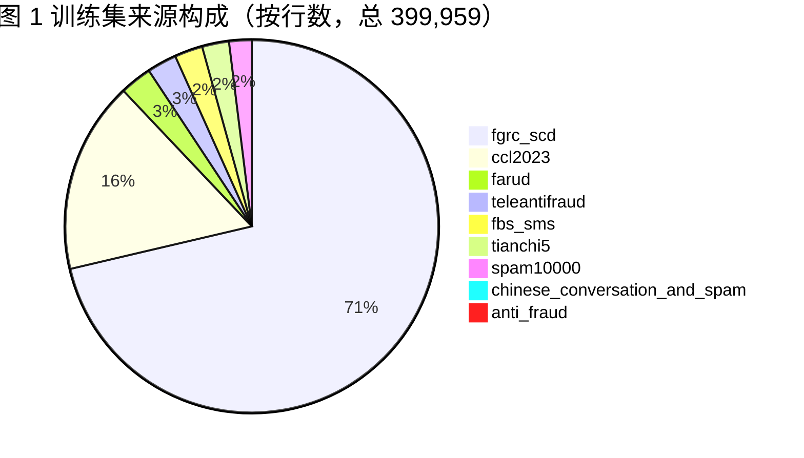
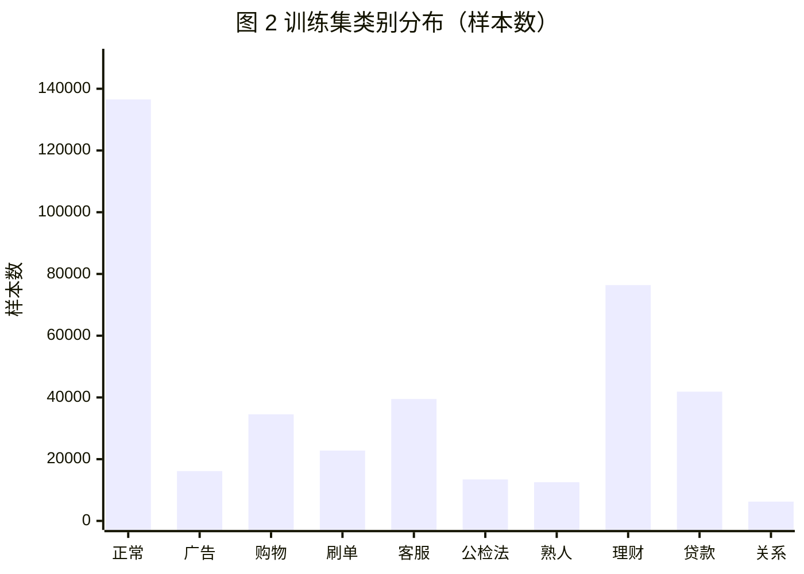
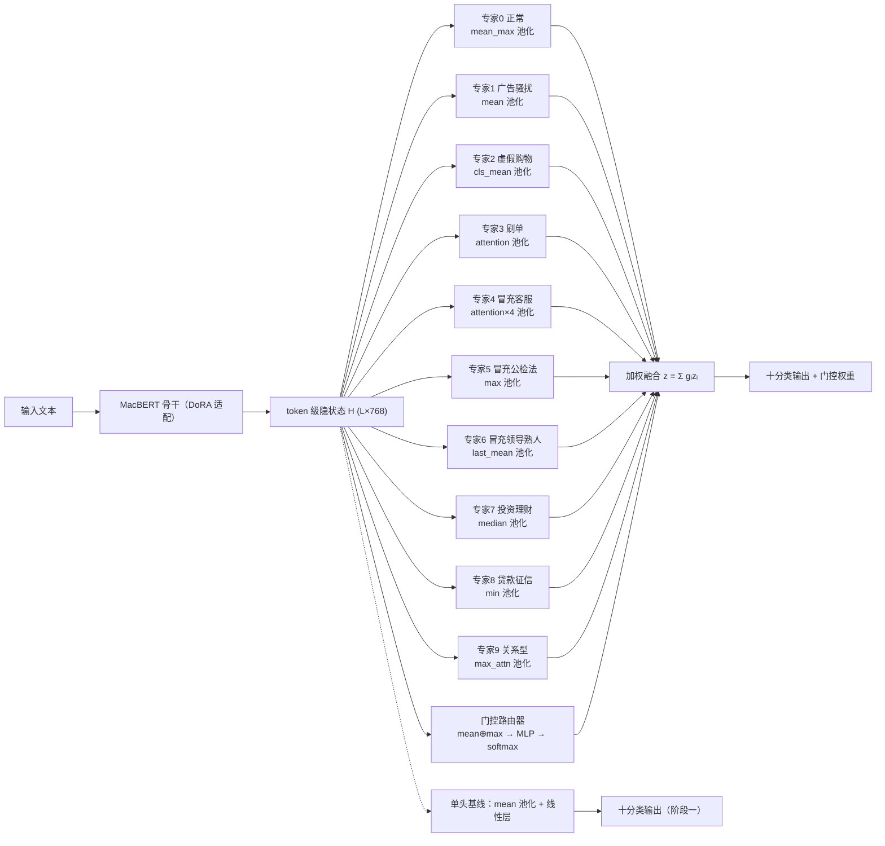
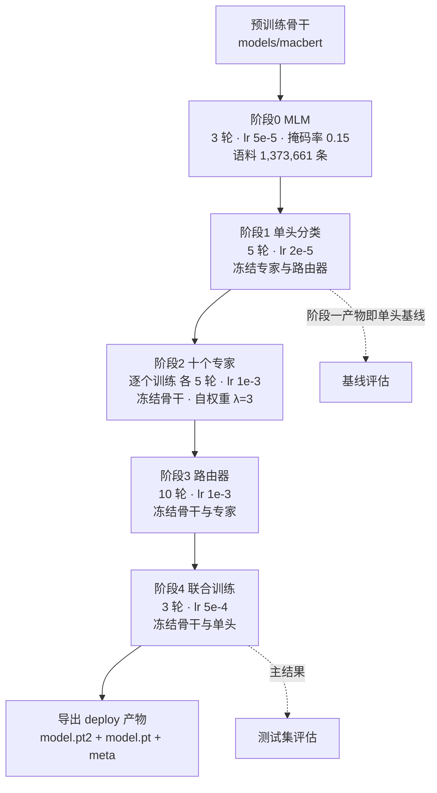
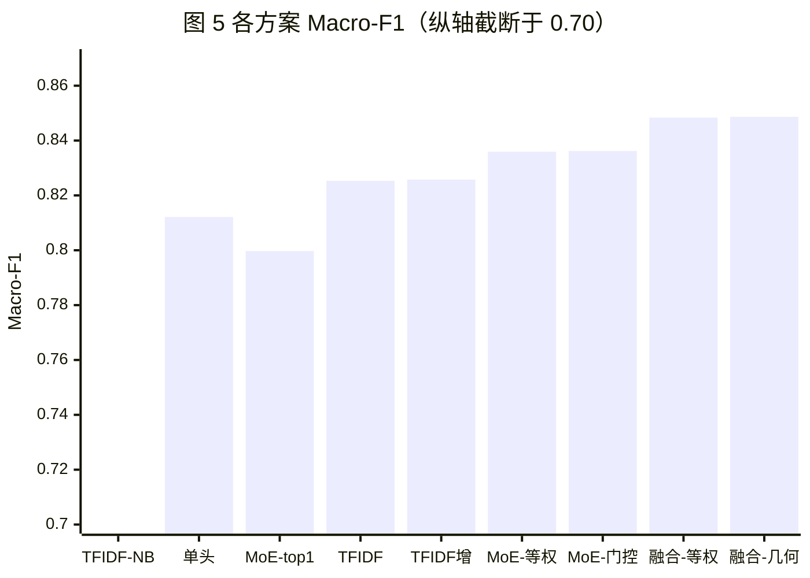
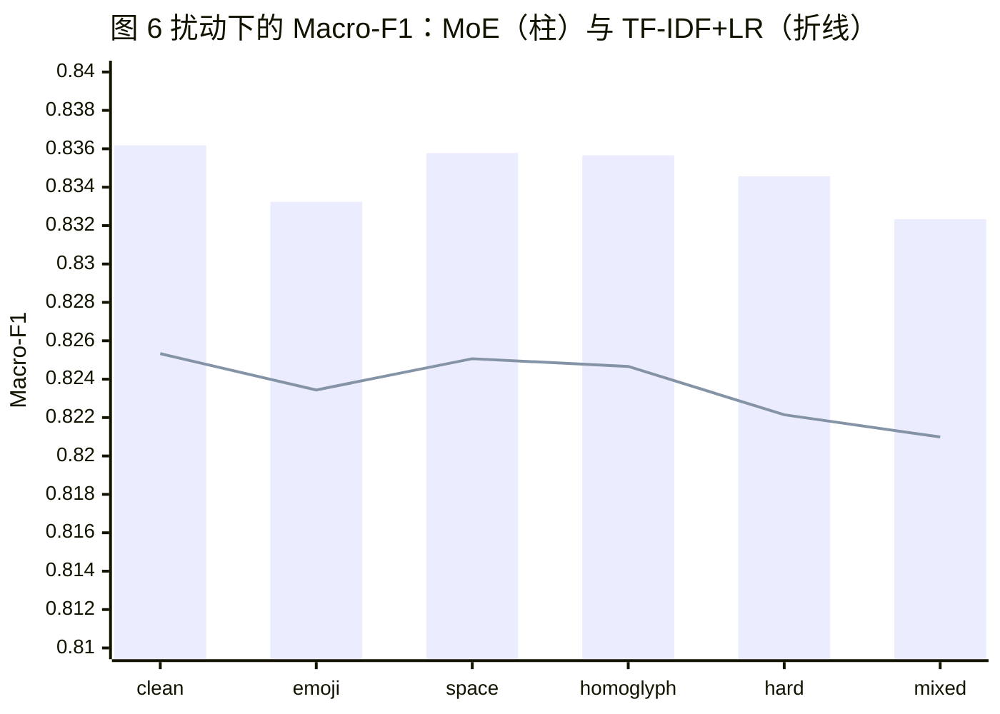
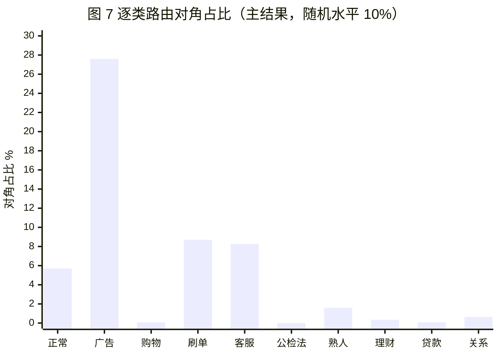
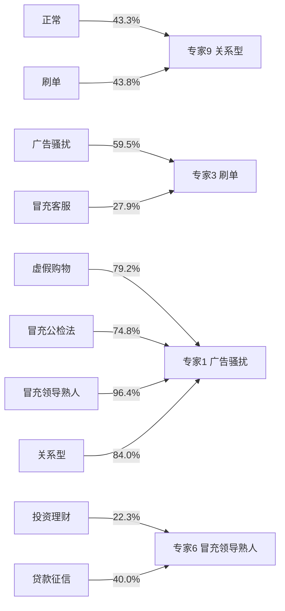
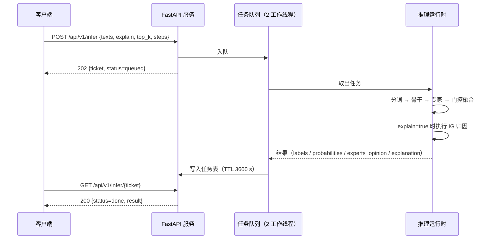

# 技术报告

## 摘要

本文的出发点是校园反诈的现实需求：高校内不同种类诈骗的话术在文本风格上差异明显，例如推销话术口语化、碎片化，刷单话术呈“小额返利并逐步升级”的渐进结构，钓鱼信息则采用正式公文口吻。基于这一观察，本文把任务从“是否为诈骗”的二分类推进到“属于哪一类话术”的十分类（正常、广告骚扰、虚假购物、刷单、冒充客服、冒充公检法、冒充领导熟人、投资理财、贷款征信、关系型），因为类别直接决定处置策略的匹配。系统以中文 MacBERT 为共享骨干、经 DoRA 低秩适配微调，在此之上并联十个异构专家与一个句级门控路由器：专家在池化算子（均值、最大值、最小值、中位数、注意力等十种）、隐层宽度与深度上各不相同，路由器依据句级表示对专家输出做软加权。训练按掩码语言模型预训练、单头分类、专家、路由器、联合五个阶段推进，分类损失采用类别平衡损失（β=0.9999）以应对 21.8∶1 的类别不平衡。

在 49,993 条测试样本上，门控融合模型的 Macro-F1 为 0.836180（95% 置信区间 [0.831288, 0.840742]），比同骨干同数据训练的单头基线 0.812128 高 2.41 个百分点（配对 bootstrap 差值 +0.024164，McNemar 精确检验 n10=1606 / n01=790，p=1.83×10⁻⁶³），比 TF-IDF+逻辑回归（0.825330）高 1.09 个百分点。门控与等权平均（0.835939）几乎相同，而 top-1 硬选择退化明显（0.799744，ECE 恶化至 0.086370），说明增益来自多专家表示的软融合，而不是稀疏选择。模型校准良好（ECE 0.004026，仅为 TF-IDF 基线的 1/11），置信度可以直接用于处置决策。

此外有三项偏离预期的发现。第一，把 MoE 与 TF-IDF 做概率级等权融合、再对融合概率做温度标定后，Macro-F1 升至 0.848383、ECE 降到 0.002728（温度在验证集上拟合），但这一收益来自两类模型错误模式的互补，而非任一单模型的能力上限。第二，专家按类分工并未出现：真实类别被路由到同序号专家的比例平均只有 5.30%，低于 10% 的随机水平（联合训练前为 3.28%），而冻结路由器可以让该统计量与专家边际都和联合训练前保持逐元素一致。第三，把负载均衡权重从 0.01 提高到 0.3 既没有修复分工，反而使路由退化，验证 Macro-F1 停在 0.8313。这三点指向同一个可检验的解释：当每个专家都在全部十类数据上训练、只对自身类别施加 3 倍权重时，专家被训练成能力相近、偏好很弱的通才，路由器缺少可学的按类信号，输出级融合的收益只能来自表示多样性。

**关键词**：诈骗文本识别；多专家门控融合；专家混合；参数高效微调；概率校准；路由坍缩

---

## 1 引言

### 1.1 研究背景与问题

本文的问题起点来自校园反诈的实际需求。本校学生遭受网络诈骗的人数长期在全市居于高位，校园场景中高发的诈骗类型集中在三类：

1. 推销诈骗：网络水军批量加入课程群、班级群，冒充老师或学长学姐私聊推销，或趁管理员不在线时在群内发布推销乃至色情引流广告，常用“已向群管理员报备”这类措辞降低戒心；
2. 刷单诈骗：通过群聊与私聊把受害者导流至恶意 App 或恶意网站，以小额返利为诱饵，逐步升级垫付任务；
3. 冒充学校与教师的个人信息钓鱼：通过群聊或已泄露的个人邮箱发送诱导信息，诱导填写学号、身份证、银行卡等敏感信息。

这三类话术在风格与结构上差异明显：推销话术口语化、碎片化，常夹带表情符号与“已报备”这类措辞；刷单话术呈“小额返利并逐步升级”的渐进结构；钓鱼信息则用正式公文口吻，带教务处/辅导员/教师等落款，并结构化地索取敏感信息。不同话术的判别依据本就不一样，这构成了本文技术路线的起点：让多个专家网络分别从不同视角（各自的池化算子）学习这些模式，再由门控路由器按输入动态组合（第 4.3 节）。

三类诈骗的共同载体都是文本（群聊消息、私聊消息、短信、邮件正文），因此本文将输入限定为纯文本，不做其余载体的额外解析。传统方法的对比由 TF-IDF + 朴素贝叶斯/逻辑回归基线承担。

在校园三类之上，本文将标签体系细化为十分类（第 3.2 节）：校园语境的“推销”对应广告骚扰（含色情引流），“刷单”对应刷单，“冒充学校/教师钓鱼”按其话术来源拆为冒充客服、冒充公检法、冒充领导熟人（“冒充教务处、辅导员”同时具备机构权威与熟人身份两种特征）；语料还覆盖了校园之外但在电信网络诈骗中同样高发的四类，虚假购物、投资理财、贷款征信、关系型（婚恋交友类）。类别越细，处置策略越能落地：同样判为诈骗，冒充公检法需触发账户止付与公安联动，刷单需触发支付渠道拦截，冒充熟人需触发联系人核验。代价是粒度变细后长尾更严重（见下文困难一）。

除背景之外，这个任务在数据与建模上还有三重困难。

1. 类别高度不平衡且长尾。训练集最大类与最小类样本数之比为 21.8∶1（34.14% 对 1.56%），直接以交叉熵优化时少数类几乎不产生有效梯度。
2. 话术线索高度词汇化，词袋模型构成强基线。语料中每类都有“一出现几乎定类”的标记词，还保留着生成器占位符（`NAME`、`DIGIT`、`PLACE`）这类捷径特征，词袋模型不做任何语义建模就能取得接近神经模型的成绩。这既是数据特性，也是本文必须处理的方法论问题：任何神经方法如果不能显著超过词袋基线，其存在价值都应当被质疑。
3. 面向对抗扰动的鲁棒性要求。真实场景中存在 emoji 变体、零宽字符与空格注入、形近字替换（如“账户”写作“賬戶”）等字符级规避手段[14]，模型需要在扰动下保持稳定。

关于研究定位，本文在设计之初就明确：如果多专家融合相对单头基线的提升落在统计噪声内，其价值就应转为可解释性与消融分析，而不是靠调参制造差距。实测结果给出的结论比这更强一些：提升是显著的（第 6.1、6.2 节），但结构中被预期起关键作用的“专家分工”并未出现（第 6.6 节）。负结果与未执行项在本文中同样如实报告。

目标部署场景是校园群聊/私聊消息的实时检测，例如接入社团群的机器人：消息经接口返回类别、置信度与可解释证据，机器人按风险等级决定提醒、折叠还是上报人工复核。这一场景对系统提出了三项要求，对应第 8 节的实现：完全离线可运行、单次调用可批量处理、给出可供人工核验的证据而不只是一个标签。

### 1.2 本文工作与贡献

本文以分类器（而非检索或生成）的视角，实现并评估了一个输出级多专家门控融合系统，工作与贡献如下：

- 方法层面：给出一个可复现的输出级异构多专家融合实现。专家之间的差异体现在池化算子、隐层结构与训练数据增强三个维度，不体现在损失函数上：所有专家共享同一形式的目标函数，各自输出的 logits 因此处于同一尺度，融合前无需额外校准；路由器在句级表示上学习软权重，融合式为专家输出的凸组合。
- 数据层面：整理并逐项核验了一个十分类中文诈骗文本数据集（3,214,684 行，其中训练 399,959、验证 49,993、测试 49,993、掩码语言建模语料 1,373,661、合成语料 1,341,078）。本文给出完整的来源构成、泄漏核查、长度分布与截断统计，并标注只使用真实与真实案件衍生语料训练，合成语料不参与任何训练或调参。
- 评测层面：在同一测试集与同一指标实现下对比 11 种配置，报告 Macro-F1 的 bootstrap 置信区间、McNemar 精确检验与配对 bootstrap 差值，并额外报告期望校准误差（ECE）与六种对抗扰动下的表现。
- 实证层面：报告并分析了三项负结果——路由未形成按类分工、提高负载均衡权重会破坏路由器、门控融合相对等权融合无实质增益。它们共同支持一个具体结论：在本设定下，MoE 的性能来源是专家表示的多样性，而不是专家分工；本文同时给出“分工何时才可能出现”的可检验条件与相应的验证脚本。

### 1.3 文章组织

第 2 节回顾相关工作；第 3 节描述数据集及其质量核查；第 4 节给出方法；第 5 节说明实验设置与统计检验口径；第 6 节报告结果；第 7 节讨论增益来源、基线强度与有效性威胁；第 8 节描述系统实现与部署；第 9、10 节给出局限、结论与后续工作；附录给出复现命令与数据溯源表。

---

## 2 相关工作

### 2.1 中文诈骗与垃圾文本识别

早期工作把涉诈文本视为垃圾文本过滤问题，主流做法是基于 TF-IDF 特征配合朴素贝叶斯或线性分类器[15,16]，其优点是训练成本极低、可解释性好，缺点是无法刻画长距离语义与话术结构。随着中文预训练模型成熟，基于 BERT[1] 及其改进版 MacBERT[2] 的微调方案成为主流：MacBERT 以“相近词替换”替代掩码语言建模中的 `[MASK]`，缓解了预训练与微调阶段的不一致，在多项中文基准上优于同规模 BERT 与 RoBERTa-wwm-ext。近年公开的中文涉诈语料（如伪基站短信、通话转写、案件笔录类语料）进一步推动了该方向，但公开语料的文体与真实用户消息之间普遍存在域偏移，直接以单一来源训练的模型在跨域场景下性能会明显下降。本文因此不追求单一来源上的极值性能，而在**多来源混合语料**上构建十类体系，并显式核查来源集中度与泄漏。

### 2.2 混合专家与输出级多专家融合

混合专家（Mixture of Experts, MoE）最早由 Jacobs 等[6]与 Jordan 和 Jacobs[7]提出，其思想是用门控网络对多个局部专家的输出做加权组合。Shazeer 等[8]将稀疏门控 MoE 引入深度网络，Fedus 等[9]提出的 Switch Transformer 以 top-1 路由把参数量扩展到万亿级，Mixtral[10]则在开源大模型上验证了稀疏 MoE 的有效性。上述工作的共同特征是**在 Transformer 中间层以大量同构专家替换前馈网络、按 token 稀疏激活**，其收益主要来自参数容量与计算量的解耦。

与这一路线不同，本文采用输出级、全激活、异构专家的融合形式：所有专家都作用于同一段文本的句级表示，新增参数（专家、路由器、单头分类层与 DoRA 适配器）合计约 10.0M，占全模型参数量的 8.9%，不存在稀疏激活带来的训练与推理不一致问题，也不改动预训练骨干的内部结构。这样的设计使模型规模与推理成本保持在单卡可部署的范围内，代价是放弃了容量扩展带来的规模收益。第 6.6 节会说明，在这种设定下专家是否真正分工是一个必须被检验的经验问题，架构本身并不保证。

### 2.3 参数高效微调与类别不平衡

LoRA[3]通过低秩增量矩阵冻结原权重、只学习增量，DoRA[4]进一步把预训练权重分解为幅度与方向两部分并分别适配，在相同可训练参数预算下通常优于 LoRA。本文采用 DoRA（r=8，α=16，作用于注意力的查询、键、值投影），可训练参数 470,016，占骨干本体（102,267,648）的 0.46%、占全模型（112,263,544）的 0.419%。

类别不平衡方面，重加权交叉熵与 Focal Loss 是通用手段，Cui 等[5]提出的类别平衡损失（Class-Balanced Loss）以有效样本数 `(1−β^{n_c})` 替代样本数 `n_c` 构造权重，在长尾识别中表现稳健。本文采用该损失，并在第 6.8 节给出 β 的敏感性证据：过度重加权会以精确率换召回率，本文的实证支持“适度重加权”，而不是“越强越好”。

### 2.4 概率校准与归因

深度网络普遍存在过度自信，Guo 等[11]系统比较了多种后处理校准方法，其中温度缩放以单一参数 `T` 调整 logits 尺度、不改变预测类别，是最简单也最稳定的做法，而ECE[18]是最常用的校准度量。本文同时报告精度与校准，并说明融合后的概率因继承词袋模型的过度自信而变差（第 6.4 节）。归因方面，Sundararajan 等[12]提出的积分梯度（IG）满足完备性与敏感性公理，适合在 embedding 空间给出 token 级贡献，本文将其用于在线解释（第 8.2 节）。

---

## 3 数据集

### 3.1 语料构成与来源

数据集以 Lance 列式格式存储（`datasets/dataset.lance`），共 **3,214,684** 行，字段为 `id / text / label10 / subtype / source / use / meta`。按 `use` 字段划分五份，按 `source` 字段可追溯至 12 个上游语料。

表 1 给出各划分的规模与用途。

**表 1 数据划分**

| `use` | 行数 | 用途 |
| --- | ---: | --- |
| `mlm` | 1,373,661 | 掩码语言模型（MLM）继续预训练 |
| `train` | 399,959 | 五阶段训练 |
| `val` | 49,993 | 阶段内选优、温度标定 |
| `test` | 49,993 | 正式评估（本文全部主结果） |
| `test_synthetic` | 1,341,078 | 仅由合成语料构成，**目前未被任何代码消费** |

三个监督划分（train/val/test）合计 499,945 行，来自 9 个上游来源；MLM 语料来自另外的 2 个大语料与 4 个来源的剩余部分；`test_synthetic` 全部来自 1 个合成来源。表 2 给出 `use × source` 的完整交叉统计（行数为空表示该来源未进入该划分）。

**表 2 各来源在不同划分中的行数**

| 来源 | train | val | test | mlm | test_synthetic |
| --- | ---: | ---: | ---: | ---: | ---: |
| `fgrc_scd` | 282,390 | 35,299 | 35,299 | — | — |
| `ccl2023` | 65,763 | 8,207 | 8,208 | — | — |
| `farud` | 10,962 | 1,370 | 1,370 | 1,177 | — |
| `teleantifraud` | 10,162 | 1,269 | 1,269 | 1,011 | — |
| `fbs_sms` | 9,642 | 1,206 | 1,206 | 970 | — |
| `tianchi5` | 9,227 | 1,165 | 1,164 | — | — |
| `spam10000` | 7,748 | 968 | 968 | — | — |
| `chinese_conversation_and_spam` | 2,456 | 307 | 307 | — | — |
| `anti_fraud` | 1,609 | 202 | 202 | 199 | — |
| `spam80w` | — | — | — | 978,922 | — |
| `chifraud` | — | — | — | 391,382 | — |
| `scamgen` | — | — | — | — | 1,341,078 |
| **合计** | **399,959** | **49,993** | **49,993** | **1,373,661** | **1,341,078** |

来源构成中有三点与后文结论直接相关：

1. 训练语料存在明显的单源依赖：`fgrc_scd` 占训练集的 70.60%，前三大来源合计占 89.8%。
2. 只使用真实与真实案件衍生语料训练：`train`/`val`/`test` 中不含任何生成模型合成语料；唯一的合成来源 `scamgen` 被隔离在 `test_synthetic` 中，当前也没有任何评估代码消费该划分。
3. MLM 语料与分类语料部分同源但不同行：`spam80w`（978,922）与 `chifraud`（391,382）合计占 MLM 语料的 99.76%，二者不进入分类训练；另有 4 个分类来源的边角行（合计 3,357 行）因标签缺失（`label10 = -1`）只参与 MLM。



### 3.2 标签体系与类别分布

标签为十分类扁平体系，`label10 ∈ {0,…,9}`，与专家序号严格一一对应（导出、服务与评估均依赖该约定）：

| id | 类别名 | 英文标识 | 含义要点 |
| ---: | --- | --- | --- |
| 0 | 正常 | `normal` | 非涉诈内容，含营销类近领域负样本 |
| 1 | 广告骚扰 | `advertising` | 推广、引流、群发广告 |
| 2 | 虚假购物 | `fake_shopping` | 虚假商品与服务交易 |
| 3 | 刷单 | `brushing` | 兼职刷单、垫付返利 |
| 4 | 冒充客服 | `impersonation_customer_service` | 以退款、理赔、账户异常为由引导操作 |
| 5 | 冒充公检法 | `impersonation_public_sec` | 以涉案、通缉、资金核查为由施压 |
| 6 | 冒充领导熟人 | `impersonation_acquaintances` | 以熟人身份借款、代办 |
| 7 | 投资理财 | `investment` | 荐股、虚拟币、平台投资 |
| 8 | 贷款征信 | `loan_credit` | 代办贷款、征信修复 |
| 9 | 关系型 | `relationship` | 婚恋交友、情感包装类话术 |

训练集类别分布与不平衡比如表 3；测试集按同一分层比例抽取，逐类支持数一并在表 3 给出（测试集支持数由混淆矩阵行和反推，与逐类 P/R/F1 完全一致）。

**表 3 类别分布与不平衡**

| 类别 | 训练集 | 占比 | 测试集 | 占比 |
| --- | ---: | ---: | ---: | ---: |
| 正常 | 136,534 | 34.14% | 17,066 | 34.14% |
| 广告骚扰 | 16,134 | 4.03% | 2,018 | 4.04% |
| 虚假购物 | 34,535 | 8.63% | 4,317 | 8.64% |
| 刷单 | 22,794 | 5.70% | 2,849 | 5.70% |
| 冒充客服 | 39,482 | 9.87% | 4,935 | 9.87% |
| 冒充公检法 | 13,434 | 3.36% | 1,679 | 3.36% |
| 冒充领导熟人 | 12,528 | 3.13% | 1,565 | 3.13% |
| 投资理财 | 76,391 | 19.10% | 9,549 | 19.10% |
| 贷款征信 | 41,875 | 10.47% | 5,234 | 10.47% |
| 关系型 | 6,252 | 1.56% | 781 | 1.56% |
| **合计** | **399,959** | 100% | **49,993** | 100% |

最大类与最小类之比为 **21.8∶1**。最小类"关系型"在测试集上只有 781 条，该规模下单个样本对逐类精确率/召回率的影响约为 0.13 个百分点，本文在逐类分析中对这一不确定性予以标注。



> 图 2 横轴为类别简称，依次对应：正常、广告骚扰、虚假购物、刷单、冒充客服、冒充公检法、冒充领导熟人、投资理财、贷款征信、关系型（下文图表同此约定）。

### 3.3 数据划分

划分按 `(label10, subtype)` 分层抽样生成，训练/验证/测试比例为 8∶1∶1：表 2 中各来源在三份中的行数基本符合该比例，`subtype` 的 70 个取值在三份中的行数比也几乎严格为 8∶1∶1，个体差异来自分层与去重。划分脚本不在本仓库内归档，上面这两条结论是从数据本身核验的（见附录 B 末段）。标签体系是扁平十类，没有引入层级分组标签：本文的专家与类别一一对应，层级结构会让类别与专家的对应关系变模糊；分类训练与评估也全部在扁平标签上进行，数据集的 `subtype` 仅作为描述性元数据，不参与任何模型计算。

### 3.4 文本长度与截断

模型的最大输入长度为 512 token。表 4 给出各划分的字符长度分布与超长比例；token 长度以 MacBERT 分词器（含特殊符号）实测。

**表 4 文本长度分布**

| 划分 | 样本数 | 字符均值 | 字符 p50 | 字符 p90 | 字符 p99 | 字符最大 |
| --- | ---: | ---: | ---: | ---: | ---: | ---: |
| train | 399,959 | 180.3 | 134 | 355 | 781 | 4,868 |
| val | 49,993 | 179.5 | 134 | 351 | 776 | 2,514 |
| test | 49,993 | 180.0 | 133 | 355 | 779 | 2,561 |
| mlm | 1,373,661 | 45.0 | 24 | 99 | 273 | 1,721 |

以分词器实测，**测试集中 2.99%（1,494 条）的样本超过 512 token 而被截断**。截断并非均匀发生：刷单类有 17.69% 的样本被截断（其余类别为 0.62%~6.15%），因为该类语料多为较长的叙述性文本（均值显著高于整体）。

> 注意：本文的 TF-IDF 基线使用全文特征，不受 512 token 限制。第 6 节的比较因此对神经模型结构性不利：它在长文本类（尤其刷单）上的成绩是在丢失尾部信息的前提下取得的。

### 3.5 数据质量核查

本文对数据集做了四项可复核的核查，结论如下。

1. 跨划分重复：以原始文本逐字比对，`train ∩ test` 完全相同的有 220 条，占测试集的 0.44%。这一量级即使被全部记忆，对 Macro-F1 的影响也远小于本文报告的置信区间宽度，但本文如实报出该数字，供后续使用者判断。
2. 划分内唯一率：`train` 唯一率 99.78%，`test` 唯一率 99.98%（存在 10 条内部重复）。该水平排除了“靠重复样本刷分”的可能。
3. 来源集中度：训练集 70.60% 来自单一来源 `fgrc_scd`（第 3.1 节），本文将其列入有效性威胁（第 7.4 节）。
4. 合成语料隔离：唯一的生成式合成来源 `scamgen`（1,341,078 行，仅覆盖类别 4/5/6）不进入任何训练、验证或调参环节，因此不影响本文结论；该划分当前也没有被任何评估流程消费，第 9 节将其列为待完成项。

---

## 4 方法

### 4.1 总体架构

系统以“共享骨干 + 异构专家 + 句级门控”三层结构组织，前向过程如下（图 3）：

1. **编码**：文本经分词后送入 MacBERT 骨干，得到 token 级隐状态序列 $H \in \mathbb{R}^{L \times d}$，$d=768$。
2. **专家**：第 $i$ 个专家先以自己的池化算子 $p_i(\cdot)$ 把 $H$ 压成句级向量，再经自身结构的 MLP 输出十类 logits：

$$z_i = E_i\big(p_i(H)\big) \in \mathbb{R}^{10},\qquad i = 1,\dots,M,\ M=10$$

3. **门控**：路由器在 $[\text{mean}(H); \text{max}(H)] \in \mathbb{R}^{1536}$ 上输出 $M$ 维软权重

$$g = \mathrm{softmax}\Big(W_2\,\mathrm{ReLU}\big(W_1\,\mathrm{Drop}(\mathrm{LN}(W_p[\text{mean}(H);\text{max}(H)]))\big)\Big)\in \mathbb{R}^{10}$$

4. **融合与分类**：以凸组合融合专家输出，softmax 后给出类别概率

$$z = \sum_{i=1}^{M} g_i z_i,\qquad \hat{y} = \arg\max_c \ \mathrm{softmax}(z)_c$$

与标准 MoE 相比，这一结构有三处不同：专家作用于句级表示而非 token 级（避免 token 路由在训练初期的梯度震荡与逐层路由塌缩）；全激活、无稀疏门控，专家、路由器与单头分类层合计占模型参数量的 8.49%（不含 DoRA 适配器），稀疏化带来的训练-推理不一致风险大于其收益；专家异构而非同构，差异来自池化算子、结构规模与训练增强（见 4.3 节）。



**图 3 总体架构**（虚线为阶段一的单头基线路径，与专家、路由器共享同一骨干）

### 4.2 骨干网络与 DoRA

骨干为 `hfl/chinese-macbert-base`（12 层、隐层 768、约 1.02 亿参数）。适配方式为 DoRA[4]：将预训练权重 $W$ 分解为幅度 $m$ 与方向 $V/\|V\|$ 两部分，仅对方向施加低秩增量、并学习幅度向量。配置为 $r=8$、$\alpha=16$、dropout 0.05，目标模块为注意力层的查询/键/值投影。参数量实测（占比列为占全模型参数量的比例）：

| 组成 | 参数量 | 占比 |
| --- | ---: | ---: |
| 骨干本体 | 102,267,648 | 91.10% |
| DoRA 适配器（可训练） | 470,016 | 0.419% |
| 十个专家 | 7,737,956 | 6.89% |
| 门控路由器 | 1,780,234 | 1.59% |
| 单头分类层 | 7,690 | 0.007% |
| **合计** | **112,263,544** | 100% |

本文使用 DoRA 不是出于算力的限制（该骨干可以在单张消费级显卡上全量微调），而是因为它在低秩预算下（可训练参数 470,016，占骨干本体 0.46%）就能获得稳定收益；本文不对 PEFT 方法本身做对比。

### 4.3 异构专家网络

十个专家的差异由三方面构成，配置见表 5。**十种池化算子**分别是：掩码均值、逐维最大值、逐维最小值、逐维下中位数、`[CLS]` 表示、后 1/3 段均值、可学习注意力池化[19]、均值与最大值拼接（2d）、`[CLS]` 与均值拼接（2d）、最大值与注意力拼接（2d）。池化实现均严格按注意力掩码处理填充位置（最大值填 `dtype.min`、最小值填 `dtype.max`、中位数以排序后取下中位数），保证 [PAD] 不会被选中。

**表 5 专家配置**

| index | 类别 | 池化算子 | 输出维数 | heads | hidden | 层数 | 数据增强（抽样率） |
| ---: | --- | --- | ---: | ---: | ---: | ---: | --- |
| 0 | 正常 | `mean_max` | 1536 | 1 | 256 | 2 | — |
| 1 | 广告骚扰 | `mean` | 768 | 1 | 256 | 1 | `emoji_replace`（0.3） |
| 2 | 虚假购物 | `cls_mean` | 1536 | 1 | 512 | 3 | `random_space`（0.2） |
| 3 | 刷单 | `attention` | 768 | 1 | 256 | 3 | — |
| 4 | 冒充客服 | `attention` | 3072 | 4 | 512 | 3 | — |
| 5 | 冒充公检法 | `max` | 768 | 1 | 384 | 2 | `homoglyph`（0.4） |
| 6 | 冒充领导熟人 | `last_mean` | 768 | 1 | 384 | 2 | — |
| 7 | 投资理财 | `median` | 768 | 1 | 512 | 2 | — |
| 8 | 贷款征信 | `min` | 768 | 1 | 384 | 2 | — |
| 9 | 关系型 | `max_attn` | 1536 | 1 | 512 | 3 | — |

设计上有两点取舍。一是专家输入取 token 级序列而非预先池化的向量：若所有专家共享同一池化结果，专家间的差异就只剩下 MLP 结构，“全局视角/极值视角/注意力视角”的分工便无从建立。二是损失函数不参与异构化，所有专家都使用同一形式的类别平衡损失：若不同专家使用不同损失（例如部分用 Focal、部分用对比损失），各专家输出 logits 的尺度将天然不可比，融合前必须引入额外校准，反而更脆弱。异构性因此被限制在结构、池化与数据增强三个维度内。

### 4.4 门控路由器

路由器是一个轻量 MLP：输入为均值与最大值池化的拼接（1536 维），依次经投影层（1536→768）、LayerNorm、dropout 0.1、隐层（768→768 + ReLU）与输出层（768→10），最后 softmax；参数量实测 1,780,234（占全模型 1.59%）。路由器没有引入温度调度，因为温度锐化与负载均衡损失的调控目标有重叠，路由分布的调控统一交给负载均衡系数（见 4.5 节）。

### 4.5 训练目标

**类别平衡损失（CB）**。以有效样本数构造类别权重[5]：

$$w_c = \frac{1-\beta}{1-\beta^{n_c}},\qquad \tilde{w}_c = \frac{C \cdot w_c}{\sum_{c'} w_{c'}}$$

其中 $n_c$ 为训练集中第 $c$ 类样本数，$C=10$。归一化后权重均值为 1，便于跨 β 比较。逐样本损失为

$$\mathcal{L}_i = \tilde{w}_{y_i} \cdot m_i \cdot \mathrm{CE}(z_i, y_i),\qquad
m_i = \begin{cases}\lambda, & y_i = s \quad(\text{专家自权重})\\ 1, & \text{否则}\end{cases}$$

本文取 $\beta=0.9999$，此时最稀有类与最常见类的权重比为 2.2∶1（$\beta=0.99999$ 时为 12.3∶1）。$\lambda=3.0$ 是设计上用来诱导分工的机制，意图是让专家对自身负责的类别更敏感；它能否真的让路由器学到按类选择，属于经验问题，第 6.6 节的诊断会给出答案。

**负载均衡损失**。为防止路由把样本过度堆给少数专家，采用 Switch Transformer 形式[9]：

$$\mathcal{L}_{\mathrm{bal}} = \alpha \cdot M \cdot \sum_{i=1}^{M} f_i \cdot p_i,\qquad \alpha = 0.01$$

其中 $f_i$ 为 batch 内硬分配（argmax）落在专家 $i$ 的样本占比（detached，不回传梯度），$p_i$ 为软权重在 batch 维的均值（梯度仅经此回传）。**总损失**为 $\mathcal{L} = \mathcal{L}_{\mathrm{CB}} + \mathcal{L}_{\mathrm{bal}}$；负载均衡项在路由与联合阶段启用，在单头阶段与专家阶段不启用（此时路由器不参与优化）。为提高数值稳定性，$f_i$ 的统计与 $p_i$ 的求均值均在 fp32 下完成，避免 bf16 下的计数精度损失。

**模型选择**：每一阶段按验证集 Macro-F1 选优并保存最优权重，测试集仅在最终评估时使用一次。

### 4.6 五阶段训练流程

训练分五个阶段，每阶段冻结不同的子模块（图 4、表 6）。这样安排是为了逐级增加耦合度：先让骨干学会任务相关的表示（单头阶段），再让专家在固定表示上各自成形（专家阶段），最后才让路由器与专家相互适应（路由与联合阶段）。若从随机初始化开始就让所有组件相互耦合，训练会明显不稳定。

**表 6 五阶段训练配置**（取值已与两轮完整训练日志逐阶段核对：每阶段"每轮批次数 × batch"等于对应划分的行数；`config.toml` 内记录的是未覆盖的基础默认值，训练时由命令行覆盖）

| 阶段 | 目标 | 冻结 | 输入权重 | 轮数 | 学习率 | batch | 关键损失 |
| --- | --- | --- | --- | ---: | ---: | ---: | --- |
| MLM | 掩码语言建模（p=0.15） | — | 预训练骨干 | 3 | 5e-5 | 64 | MLM |
| stage1 分类头 | 单头 MacBERT+DoRA 基线 | 专家、路由器 | MLM | 5 | 2e-5 | 64 | CB |
| stage2 专家 | 十个专家（逐个训练） | 骨干 | stage1 | 5 | 1e-3 | 128 | CB + 自权重 |
| stage3 路由 | 路由器 | 骨干、专家 | stage2 | 10 | 1e-3 | 128 | CB + 均衡 |
| stage4 联合 | 专家 + 路由器 | 骨干、单头 | stage3 | 3 | 5e-4 | 64 | CB + 均衡 |

优化器统一为 AdamW[20]（权重衰减 0.01，warmup 比例 0.05，线性预热 + 线性衰减）。训练与阶段内评估均使用 bf16 自动混合精度，但损失在 fp32 下计算。



**图 4 五阶段训练流程**（虚线为被复用的中间产物）

### 4.7 数据增强

三个专家按类别的表层变异特点施加针对性增强，其余七个专家不增强（因此不支付该开销）：

| 专家 | 算子 | 抽样率 | 算子自身命中率 | 实测整体改写率 |
| --- | --- | ---: | ---: | ---: |
| 1 广告骚扰 | `emoji_replace`（关键词→表情） | 0.3 | 0.664 ± 0.004 | **0.199 ± 0.004** |
| 2 虚假购物 | `random_space`（随机插入空格） | 0.2 | 0.952 ± 0.002 | **0.193 ± 0.004** |
| 5 冒充公检法 | `homoglyph`（形近字替换） | 0.4 | 0.526 ± 0.004 | **0.210 ± 0.004** |

> 表中"算子自身命中率"与"整体改写率"是在训练集上均匀随机抽取 50,000 条样本（seed=42）实测的结果，括号内为 95% 置信半宽。"整体改写率"等于"被增强样本比例"与"算子命中率"的乘积，设计增强强度时必须区分这两个量：抽样率相同不代表剂量相同。三者的实测改写率被对齐在 19%~21%，即三个专家的增强剂量量级一致。

同形字表在项目中期做过一次修复。早期版本的同形字表只有 10 对，且用"形状相似度"指标 `char_similar_z` 做筛选闸门（阈值 0.7）。项目自测记录发现该指标识别不了真正的形近字：`户→戶`（肉眼几乎一致）只得 0.443、`账→賬` 0.506、`东→東` 0.571，而 `户→永` 反而得 0.750。原表 10 对里只有 2 对能通过闸门，实际改写率仅 2.8%，这项增强在早期版本中几乎完全失效。修复方式是弃用该闸门，改为人工核定 77 对形近字（多为繁简与异体关系，如 `账→賬`、`银→銀`、`门→門`、`页→頁`），并以抽样率 0.4 把实际改写率对齐到约 21%。

### 4.8 训练工程

三项工程优化在训练与预检脚本中默认开启，其收益由预检脚本单独测量。这里要区分两台机器：表 7 是在开发机（笔记本 RTX 4060 Laptop 8GB、70W 限功耗）上用真实模型与真实数据跑出的预估，用途是选型与估算训练时间（同一脚本可在训练机上重跑，见附录 A）；正式的训练与评估全部在 AutoDL 的 GPU 服务器（第 5.1 节）上完成，两者不是同一台机器。

**表 7 工程优化收益（开发机预检脚本实测）**

| 指标 | 关闭优化 | 开启优化 | 倍数 |
| --- | ---: | ---: | ---: |
| train 集批长（batch=32） | 486 | 176 | 0.36× |
| mlm 集批长（batch=32） | 227 | 53 | 0.23× |
| 单步耗时·骨干参与训练（batch=16×410） | 993 ms | 346 ms | 2.87× |
| 单步耗时·骨干冻结（batch=16×410） | 326 ms | 167 ms | 1.95× |
| 全流程预估（不含验证） | 250.4 h | 40.0 h | 6.26× |

分项收益（相对 40.0 h）：仅关闭长度分桶 → 115.3 h；仅关闭 AMP → 85.7 h。三项优化的原理分别是：

- bf16 自动混合精度[21]：损失仍在 fp32 下计算；bf16 与 fp32 的指数范围一致，因此不需要 GradScaler，GPU 不支持时自动退化为 fp32。数值影响实测很小——同一初始化下训练 30 步，参数更新量的模长相差 0.02%、方向余弦 0.998。
- 长度分桶采样：批内长度接近可以压掉动态 padding 的浪费。文本长度呈长尾分布时，随机组批的批内最长样本远高于真实均值（train 集 2.67 倍、mlm 集 4.89 倍），这部分补齐的算力不带来信息增益。实现上先把样本随机切成大块、块内按长度排序组批，样本组合仍属随机子集。
- 多进程分词：分词与增强都在 `collate` 中完成，是纯 CPU 的 Python 代码（单进程约 2.3k 样本/秒），在较快的 GPU 上会成为数据供给瓶颈，故以多进程并行；每个 worker 固定单线程并按 worker 种子重播随机数，避免各进程产生重复的增强样本。

---

## 5 实验设置

### 5.1 硬件与软件

本文的训练与全部评估实验都在租用的 AutoDL GPU 服务器上完成，不在开发机上运行。开发机只用于代码开发与表 7 的优化收益估算；训练机上也运行同一套预检脚本，用于确认真实数据下的耗时与显存。

| 项 | 值 |
| --- | --- |
| 平台 | AutoDL GPU 服务器（单卡实例） |
| GPU | NVIDIA RTX PRO 6000 Blackwell Server Edition（96 GB） |
| CPU / 内存 | 22 逻辑核（cgroup 配额）/ 110 GiB |
| 软件 | Ubuntu 22.04 · Python 3.12.3 · PyTorch 2.12.1+cu130 · transformers 5.19.0 · peft 0.21.2 |
| 训练耗时 | 主实验（第二轮）3.6 小时；含环境准备、预检与全部评估实验的完整流程 6.5 小时 |

### 5.2 超参数

除 4.6 节表 6 所列，其余关键超参数为：随机种子 42；最大序列长度 512；DoRA $r=8$、$\alpha=16$、dropout 0.05、目标模块 `[query, key, value]`；路由器 `dim=768`、dropout 0.1；CB 损失 $\beta=0.9999$；专家自权重 $\lambda=3.0$；负载均衡系数 $\alpha=0.01$；优化器 AdamW，权重衰减 0.01，warmup 0.05。

### 5.3 评测协议与统计检验

全部对比在同一测试集（49,993 条）与同一指标实现下完成，指标代码集中在 `train/common/metrics.py`，避免不同实验各自实现导致的不可比。

- **Accuracy 与 Macro-F1**：Macro-F1 对十类等权平均，缺类时显式补零，保证不同配置的标签表一致。
- **逐类 P/R/F1**：显式传入完整标签表。
- **ECE（期望校准误差）**：10 个等宽分箱，

$$\mathrm{ECE} = \sum_{k=1}^{10}\frac{|B_k|}{N}\Big|\mathrm{acc}(B_k) - \mathrm{conf}(B_k)\Big|$$

其中置信度取最大 softmax 概率。ECE 越低表示置信度越接近真实正确率。
- **Bootstrap 置信区间**：对测试集做 1,000 次有放回重采样，报告 Macro-F1 的 95% 区间（种子 42）。
- **McNemar 精确检验**：只统计两模型预测不一致的样本（$n_{01}$ 为对照正确而主模型错误、$n_{10}$ 为主模型正确而对照错误），用精确二项检验给出 p 值，避免 χ² 近似在小计数下的偏差[13]。
- **配对 bootstrap 差值**：在同一重采样索引下计算两模型 Macro-F1 之差，报告 95% 区间[17]。

### 5.4 对比方案

| 配置名 | 说明 |
| --- | --- |
| `tfidf_nb` | jieba 词级 1–2 gram TF-IDF（`min_df=2`）+ 多项式朴素贝叶斯 |
| `tfidf_lr` | 同上特征 + 逻辑回归（`max_iter=1000`） |
| `tfidf_nb_aug` / `tfidf_lr_aug` | 训练集混入按增强算子改写的样本后重新拟合（公平对照） |
| `macbert_dora_single` | MacBERT + DoRA 单头（阶段一产物） |
| `moe_gated` | 门控融合（本文主结果） |
| `moe_equal` | 消融 A1：等权平均融合（不使用路由器） |
| `moe_top1` | 消融 A2：top-1 硬选择融合 |
| `fusion_equal` / `fusion_geometric` | MoE 与 TF-IDF 的概率级融合（算术平均 / 对数池几何平均） |
| `fusion_calibrated` | 在验证集拟合温度后对融合概率做温度缩放 |

为排除“传统基线训练数据更干净”这一不公平因素，本文额外训练了增强版 TF-IDF：以 0.3 的概率对每个训练样本随机施加三个算子之一，实际新增 85,724 条改写样本（399,959 → 485,683），词汇表由 902,775 维增至 1,250,571 维。

### 5.5 复现

训练、评估、消融与诊断均由命令行入口驱动，配置优先级为命令行 > 配置文件 > 环境变量。完整命令见附录 A；全部结果 JSON 及其生成脚本的对应关系见附录 B。

---

## 6 结果与分析

### 6.1 主结果

表 8 给出全部配置在测试集上的结果（精确到 6 位小数）。

**表 8 测试集主结果（n=49,993）**

| 方案 | Accuracy | Macro-F1 | 95% CI（Macro-F1） | ECE |
| --- | ---: | ---: | --- | ---: |
| **MoE 门控（主结果）** | **0.883124** | **0.836180** | **[0.831288, 0.840742]** | **0.004026** |
| MoE 等权融合（A1） | 0.882924 | 0.835939 | [0.831244, 0.840347] | 0.007339 |
| MoE top-1 硬选择（A2） | 0.849899 | 0.799744 | [0.794719, 0.804279] | 0.086370 |
| MacBERT+DoRA 单头 | 0.866801 | 0.812128 | [0.807045, 0.816504] | 0.013697 |
| TF-IDF + 逻辑回归 | 0.879103 | 0.825330 | [0.820191, 0.830156] | 0.046092 |
| TF-IDF + 朴素贝叶斯 | 0.738943 | 0.568154 | [0.562604, 0.573847] | 0.156105 |
| TF-IDF + LR + 文本增强 | 0.879543 | 0.825752 | [0.820739, 0.830820] | 0.039781 |
| TF-IDF + NB + 文本增强 | 0.735203 | 0.562151 | [0.556862, 0.567732] | 0.161262 |
| 融合：等权算术平均 | 0.893125 | 0.848383 | [0.843524, 0.852664] | 0.042223 |
| 融合：几何平均（对数池） | **0.893565** | **0.848657** | [0.843807, 0.853119] | 0.050399 |
| **融合：等权 + 温度标定** | 0.893125 | 0.848383 | [0.843524, 0.852664] | **0.002728** |



> 图 5 横轴："TFIDF-NB/增" 指 TF-IDF+朴素贝叶斯与增强版 TF-IDF+逻辑回归；"MoE-等权/门控" 为消融 A1 与主结果；"融合-等权/几何" 指 MoE 与 TF-IDF 的概率融合。

表 8 的结果可以分成三方面来看。

其一，门控融合显著优于同数据训练的单头基线：0.836180 对 0.812128，高出 2.41 个百分点，第 6.2 节的配对检验给出 p=1.83×10⁻⁶³。其二，门控融合略优于强词袋基线，相对 TF-IDF+LR 高 1.09 个百分点，优势并不宽裕。其三，门控与等权融合基本等价（0.836180 对 0.835939，差 0.000241，远小于任一模型的置信区间宽度），而 top-1 硬选择退化 3.64 个百分点，这一组对比证明收益来自“融合”而不是“选择”。

此外，两种概率融合都高于门控本身（几何平均 0.848657，比门控高 1.25 个百分点），说明多专家模型与词袋模型之间的互补性，比单模型内部的融合方式更值得关注，详见第 6.4 与 6.7 节。

### 6.2 显著性检验

**表 9 显著性检验（同一测试集，n=49,993）**

| 对比 | $n_{10}$（主模型对/对照错） | $n_{01}$（对照对/主模型错） | McNemar p | 配对 ΔMacro-F1（95% CI） |
| --- | ---: | ---: | ---: | --- |
| MoE 门控 vs 单头 MacBERT+DoRA | 1,606 | 790 | 1.831360×10⁻⁶³ | +0.024164 [0.020733, 0.027684] |
| 融合等权 vs MoE 门控 | 973 | 473 | 4.062912×10⁻⁴⁰ | +0.012168 [0.009727, 0.014548] |
| 融合等权 vs TF-IDF+LR | 1,429 | 728 | 3.080566×10⁻⁵² | +0.023048 [0.019680, 0.026781] |

三组对比的 p 值都远小于 10⁻³⁹，配对差值区间均不含 0，差异在统计上高度显著。显著性与幅度是两个指标：MoE 相对单头的 +0.024164 是本任务中真正可观的差距，门控相对等权的差值只有 0.000241，远小于任一模型的置信区间宽度。这里要说明的是，单头基线与门控模型分别取自五阶段流程的第 1 阶段与第 4 阶段，两者之间的差距包含流程本身的贡献，并不等同于“十个专家相对一个分类头”的净效应（见第 7.4 节）。另外，等权融合的那次评估没有落盘逐样本预测，因此本文没有对“门控 vs 等权”做正式检验，只依据差值量级与第 6.7 节的消融判断二者不可区分，不在此处作显著性声明。

### 6.3 逐类表现

表 10 给出主模型、单头基线与 TF-IDF 的逐类 F1 对照（主模型另给精确率/召回率）。

**表 10 逐类指标（MoE 门控）与基线对照**

| 类别 | MoE P | MoE R | MoE F1 | 单头 F1 | TF-IDF+LR F1 | 融合 F1 |
| --- | ---: | ---: | ---: | ---: | ---: | ---: |
| 正常 | 0.958613 | 0.978554 | 0.968481 | 0.958348 | 0.967117 | 0.9731 |
| 广告骚扰 | 0.943387 | 0.957879 | 0.950578 | 0.927988 | 0.931824 | 0.9573 |
| 虚假购物 | 0.775133 | 0.709057 | 0.740624 | 0.707547 | 0.734797 | 0.7616 |
| 刷单 | 0.942236 | 0.973324 | 0.957528 | 0.948204 | 0.929866 | 0.9581 |
| 冒充客服 | 0.819304 | 0.672543 | 0.738705 | 0.722326 | 0.744976 | 0.7610 |
| 冒充公检法 | 0.875622 | 0.838594 | 0.856708 | 0.830825 | 0.837612 | 0.8714 |
| 冒充领导熟人 | 0.797782 | 0.781470 | 0.789542 | 0.748922 | 0.783569 | 0.8095 |
| 投资理财 | 0.864450 | 0.930988 | 0.896486 | 0.885698 | 0.898902 | 0.9062 |
| 贷款征信 | 0.796650 | 0.836072 | 0.815885 | 0.790318 | 0.813259 | 0.8269 |
| 关系型 | 0.705438 | 0.597951 | 0.647263 | 0.601100 | 0.611382 | 0.6588 |
| **宏平均** | 0.847861 | 0.827643 | 0.836180 | 0.812128 | 0.825330 | 0.848383 |

其一，MoE 在全部十个类别上都优于单头，提升最大的是两个最难的类别：关系型 +0.046、冒充领导熟人 +0.041，其次是贷款征信与冒充公检法，各 +0.026。

其二，MoE 相对 TF-IDF+LR 的领先集中在关系型（+0.0359）、刷单（+0.0277）、冒充公检法（+0.0191）与广告骚扰（+0.0188），在冒充客服（−0.0063）与投资理财（−0.0024）上略低。“领先幅度最大”指的是两类模型之间的差距，并不表示 MoE 在这些类别上表现好：关系型上两个模型都很弱（F1 分别只有 0.647 与 0.611，是十个类别中最低的），MoE 只是相对退化得少一些。两类模型的强弱分布互补，融合后的逐类 F1 在十个类别上都不低于两者中较优的一方，这是第 6.4 节概率融合有效的原因。

其三，最弱的两类是虚假购物（0.741）与关系型（0.647），但两者成因不同。虚假购物有 4,317 条测试样本，样本量不是问题，困难来自它与"正常"中的营销类近领域负样本边界模糊；关系型则两头受制——话术与其他类别重叠，测试样本又只有 781 条，抽样波动大，1 条样本就能让该类召回率变动约 0.13 个百分点。因此关系型在表 10 中的数值应视为粗略指示，上一条提到的 +0.046 与 +0.0359 两个"最大差距"同样带有这一不确定性。

### 6.4 概率融合与温度标定

MoE 与 TF-IDF 的错误模式互补，因此本文考察两者的概率级融合，主结果采用不调参的等权算术平均：

$$p_{\text{fuse}}(c) = \tfrac{1}{2}\,p_{\text{MoE}}(c) + \tfrac{1}{2}\,p_{\text{TF-IDF}}(c)$$

融合后 Macro-F1 达 0.848383，相对 MoE 提升 1.22 个百分点（配对 ΔF1 +0.012168，p=4.06×10⁻⁴⁰）；几何平均（对数池）给出几乎相同的结果（0.848657），说明结论不依赖具体的融合算子。

融合有一个副作用：概率的校准被拖累。MoE 单独使用时 ECE 只有 0.004026，融合后升到 0.042223，原因是 TF-IDF+LR 严重过度自信（ECE 0.046092），其置信度在平均中被继承了下来。温度缩放可以修复这一点：在验证集上以最小化负对数似然拟合温度 $T$，得 $T = 0.769135$，再在测试集上应用

$$p_T(c) = \mathrm{softmax}\big(z/T\big)_c$$

由于 argmax 不变，精度与 Macro-F1 完全不变（0.893125 / 0.848383），而 ECE 从 0.042223 降到 0.002728（降低 93.5%），优于 MoE 单模型。

> 说明：温度在验证集（49,993 条，与训练集和测试集均不重叠）上拟合，测试集只用于最终报告，不存在在测试集上调参的问题。为完整起见，本文也做了融合权重的网格敏感性检查（权重 0.1~0.9、步长 0.1），Macro-F1 在 0.832274~0.848383 之间变化，最大值出现在 0.5；报告仍取等权，不把网格最优点当作结论。

### 6.5 扰动鲁棒性

本文按“与训练同款的算子与剂量”对测试集施加扰动，并额外构造加强版攻击，观察两模型性能的相对退化。TF-IDF 始终在干净训练集上拟合，仅在测试时施加扰动（保持“攻击发生在推理输入上”的现实设定）。

**表 11 扰动鲁棒性（测试集 Macro-F1 与 ECE）**

| 变体 | 说明 | MoE 门控 | TF-IDF+LR | 差值（MoE−TFIDF） | MoE ECE | TFIDF ECE |
| --- | --- | ---: | ---: | ---: | ---: | ---: |
| clean | 无扰动 | 0.836180 | 0.825330 | +0.010849 | 0.004026 | 0.046092 |
| emoji_replace | 关键词→表情（抽样率 0.3） | 0.833242 | 0.823439 | +0.009803 | 0.004584 | 0.047756 |
| random_space | 随机空格（抽样率 0.2） | 0.835781 | 0.825067 | +0.010714 | 0.003838 | 0.047879 |
| homoglyph | 形近字替换（抽样率 0.4） | 0.835663 | 0.824664 | +0.011000 | 0.004326 | 0.046986 |
| homoglyph_hard | 同算子加强：逐字替换率 0.25 | 0.834567 | 0.822145 | +0.012422 | 0.004450 | 0.051981 |
| mixed | 三算子依次施加 | 0.832335 | 0.820990 | **+0.011345** | 0.004564 | 0.049912 |



其一，MoE 在全部六个变体下都优于 TF-IDF+LR。部分扰动变体上差距（0.0098~0.0124）略大于干净集（0.0108），但趋势不单调，其中加强版同形字攻击下最大；但趋势并不单调——最强的混合扰动下差距（0.0113）反而小于加强版同形字攻击。因此这批数据支持的结论只是“扰动没有削弱 MoE 的相对优势”，还不足以支持“优势随攻击强度递增”。一个可能的解释是表层线索被削弱后词袋模型缺少替代信号，而神经模型仍可利用上下文，但本文未做验证。

其二，两个模型的绝对退化都很小：MoE 在最强扰动下只降 0.38 个百分点（0.836180 → 0.832335），TF-IDF 降 0.43 个百分点。扰动算子改变了表层形式，但未破坏标记词的可分性，这也说明该语料的表层变异性本就不高，鲁棒性实验的区分度有限。

其三，MoE 的校准优势在扰动下保持：所有变体下 ECE 都在 0.0046 以内，TF-IDF 始终在 0.046 以上，相差一个数量级。

### 6.6 路由行为诊断

多专家结构的设计意图是让专家按话术类型分工，但“配置了十个专家”不等于“专家真的分工”，这一节要检验的正是后者。检验方式是统计测试集上的“真实类别 × 门控选中专家”列联矩阵（49,993 × 10），由此定义两个统计量：

- 对角占比：真实类别 $i$ 被路由到专家 $i$ 的比例。若按类别分工成立，它应显著高于 10% 的随机水平；
- 专家边际：每个专家承接的样本占比（理想各约 10%），用其标准差度量均衡性。

**表 12 路由诊断：三种权重下的分工与均衡**

| 权重 | 对角占比均值 | 专家边际标准差 | 专家边际（10 个专家，%） |
| --- | ---: | ---: | --- |
| 阶段三路由（联合训练之前） | **3.28%** | 3.90 pp | 7.8 / 16.0 / 5.8 / 6.4 / 17.5 / 10.2 / 12.6 / 9.5 / 7.0 / 7.3 |
| 联合训练后（主结果） | **5.30%** | 8.02 pp | 5.6 / 24.3 / 1.5 / 16.7 / 9.0 / 1.0 / 13.1 / 3.5 / 3.9 / 21.5 |
| 联合阶段冻结路由器 | **3.28%** | 3.90 pp | 与阶段三完全一致 |

三种权重下对角占比都低于 10% 的随机水平，按类别分工从未出现。联合训练还把专家边际从相对均衡（标准差 3.90 个百分点）推向偏斜（8.02 个百分点）。一个自然的推断是路由坍缩，拿到更多样本的专家进步更快，路由器于是更倾向它；但本文没有做能把它与其它解释区分开的实验，这里只把它作为待检验的可能机制列出。





**图 8 类别→专家的主要流向（每类仅绘制占比最高的一条流向；表 12b 给出前两条流向与对角占比）**

**表 12b 各类别的流向明细（主结果权重，测试集）**

| 类别 | 主要流向（占比） | 次主要流向（占比） | 对角占比（流向同序号专家） |
| --- | --- | --- | ---: |
| 正常 | 专家9 关系型（43.3%） | 专家1 广告骚扰（11.7%） | 5.70% |
| 广告骚扰 | 专家3 刷单（59.5%） | 专家1 广告骚扰（27.6%） | 27.60% |
| 虚假购物 | 专家1 广告骚扰（79.2%） | 专家3 刷单（10.4%） | 0.07% |
| 刷单 | 专家9 关系型（43.8%） | 专家6 冒充领导熟人（17.0%） | 8.70% |
| 冒充客服 | 专家3 刷单（27.9%） | 专家1 广告骚扰（21.1%） | 8.27% |
| 冒充公检法 | 专家1 广告骚扰（74.8%） | 专家3 刷单（13.6%） | 0.00% |
| 冒充领导熟人 | 专家1 广告骚扰（96.4%） | 专家6 冒充领导熟人（1.6%） | 1.60% |
| 投资理财 | 专家6 冒充领导熟人（22.3%） | 专家9 关系型（20.7%） | 0.34% |
| 贷款征信 | 专家6 冒充领导熟人（40.0%） | 专家0 正常（20.9%） | 0.08% |
| 关系型 | 专家1 广告骚扰（84.0%） | 专家3 刷单（7.7%） | 0.64% |

逐类看，偏差非常明显："冒充领导熟人"有 96.4% 的样本被路由到专家 1（广告骚扰），"关系型"84.0%、"虚假购物"79.2%、"冒充公检法"74.8% 也流向专家 1；反方向上，专家 2（虚假购物）只承接 1.5%、专家 5（冒充公检法）只承接 1.0% 的样本，接近"死亡专家"。十个类别中只有"广告骚扰"的对角占比（27.6%）明显高于其它类别，而它对应的专家 1 同时也是最被滥用的专家。

对这样的现象，合理的解释是，每个专家都在全部十类数据上训练，只对自身负责的类别施加 3 倍权重。按第 4.5 节的类平衡权重与 $\lambda=3$ 计算，"自己的类"在专家损失中的权重份额从 8.91%（最稀有类"关系型"）到 58.58%（最常见类"正常"）不等：冒充领导熟人（11.41%）、冒充公检法（11.79%）、广告骚扰（12.96%）等长尾类别的专家有近九成权重来自其它九类，即便是最常见类的专家也有四成以上权重来自其它类别。也就是说，专家从训练目标上就被塑造成能力相近、只有很弱偏好的通才。路由器面对十个这样的专家，缺少"按类选择"的可学信号，最终学到的选择偏好与类别标签几乎无关，边际分布看起来相对比较均衡，但与真实类别的对齐接近随机。

### 6.7 消融实验

**（1）融合方式（A1/A2）**。等权平均（0.835939）与门控（0.836180）在噪声范围内持平；top-1 硬选择降到 0.799744（低 3.64 个百分点），ECE 恶化到 0.086370（是门控 0.004026 的 21.5 倍）。结合第 6.6 节的路由诊断，两者可以解释为：路由器并没有学到有意义的专家选择，而硬选择把这个无信息的 argmax 变成了不可逆的承诺，样本一旦被路由到不合适的专家，就只能接受该专家的全部错误；软融合至少保留了其它专家的信息，起到集成平均的作用。这解释了 top-1 在本设定下为何表现最差。

**（2）负载均衡权重的负结果**。把 $\alpha$ 由 0.01 提高到 0.3（30 倍）并重训路由阶段 5 轮：

| $\alpha$ | 验证 Macro-F1 | 门控硬分配 $f_i$ 的逐轮形态 |
| --- | ---: | --- |
| 0.01（默认） | 0.833749 | 分布于多个专家，边际标准差 3.90 pp |
| 0.3 | 0.831300 | 每轮 100% 落于单一专家，且逐轮在不同专家间跳动 |

硬分配（argmax）逐轮 100% 落在某一个专家上、每轮还换一个专家，而五轮的验证 Macro-F1 一直停在 0.8313。两者合起来说明软权重已经接近均匀，只有各专家的软权重相差无几时，argmax 才会由数值噪声决定，才会出现"整批只给一个专家、但逐轮又换人"的形态。此时门控已无选择能力，均衡项主导了总损失。结论是：单纯增大均衡系数不是修复分工的途径，均衡项约束的是边际分布，而分工要求的是"类别→专家"的对齐，两者不是一回事。

**（3）联合阶段冻结路由器**。既然联合训练会把边际分布推向偏斜，一个自然的对策是在联合阶段冻结路由器：

| 配置 | 验证 Macro-F1 | 专家边际标准差 | 路由矩阵 |
| --- | ---: | ---: | --- |
| 联合训练（解冻路由器） | 0.835862 | 8.02 pp | 见 6.6 节 |
| 联合训练（冻结路由器） | 0.835700 | 3.90 pp | 与阶段三逐元素一致 |

冻结路由器只付出 0.0002 的验证指标代价（落在验证集噪声内），就保住了专家边际的均衡性与路由统计量的稳定性，可以作为工程默认值。但要注意它保住的是分布均衡，不是按类分工：对角占比仍是 3.28%，分工问题没有被解决。

### 6.8 损失重加权的敏感性：两轮训练

本文的实验分为两轮，两轮使用同一数据集、同一测试集与同一套评估代码，batch 与各阶段轮数也相同（见 4.6 节表 6），但并非严格的单变量对照。两轮之间可确认的差异有两项：CB 损失的 $\beta$ 由 0.99999 改为 0.9999（最稀有/最常见类权重比 12.3∶1 → 2.2∶1）；同形字增强由 10 对字表、抽样率 1.0（实际改写 2.8%）改为 77 对字表、抽样率 0.4（实际改写 21.0%）。两轮之间的整体提升因此不能全部归因于 β，本文的处理方式如下。

**表 13 两轮训练的阶段验证指标（Macro-F1）**

| 阶段 | 第一轮（β=0.99999） | 第二轮（β=0.9999） | 差值 |
| --- | ---: | ---: | ---: |
| stage1 分类头 | 0.800058 | **0.815983** | +0.015925 |
| stage2 十专家（均值） | 0.794854 | **0.820603** | +0.025749 |
| stage3 路由 | 0.811165 | **0.833749** | +0.022584 |
| stage4 联合 | 0.812532 | **0.835862** | +0.023330 |

**表 14 两轮测试集主结果**

| 方案 | 第一轮 | 第二轮 | 差值 |
| --- | ---: | ---: | ---: |
| MoE 门控 | 0.812886 | **0.836180** | +0.023294 |
| MoE 等权 | 0.814977 | **0.835939** | +0.020962 |
| MoE top-1 | 0.731891 | **0.799744** | +0.067853 |
| 单头 MacBERT+DoRA | 0.797198 | **0.812128** | +0.014930 |
| TF-IDF + 逻辑回归 | 0.825223 | 0.825330 | +0.000107（重拟合差异） |

论证策略是：单头阶段（stage1）不使用任何数据增强，两轮的骨干初始化、数据、batch 与轮数也一致，两项已知差异中只有 β 作用于该阶段，因此 stage1 的 +0.015925 只能来自损失重加权。同一方向、幅度更大的提升出现在含增强的后续阶段。反向证据同样清楚：第一轮的 MoE 门控（0.812886）比同轮 TF-IDF+LR（0.825223）低 1.23 个百分点，即过度重加权让神经模型系统性地落后于词袋基线；第二轮修正后反超 1.09 个百分点。

---

## 7 讨论

### 7.1 增益来源：多样性，而非分工

把第 6 节的证据串起来，可以得到一条内部自洽的解释：

1. 门控融合相对单头基线高 0.024164（p=1.83×10⁻⁶³），说明多个专家的组合确实带来了单个分类头没有的信息；
2. 门控与等权融合不可区分（差 0.000241），说明路由器没有提供额外的选择能力；
3. 路由诊断否定了“按类分工”这一设计意图（对角占比 5.30%，低于随机水平 10%）；
4. 硬选择（top-1）大幅退化 3.64 个百分点，说明被放大的“选择”是无信息的。

据此，本文模型的有效成分可以这样描述：十个在池化视角、结构容量与增强数据上互不相同的专家，对同一表示给出十个略有差异的判断，经软融合平均后抵消了各自的方差。这与集成学习的一般图景一致，也解释了等权融合为何如此接近门控。本文并未证明等权在一般意义下最优，只是观察到在本设定下它与门控不可区分。

对“专家混合”类方法，这一结果的实践含义是：在输出级、全激活、数据同质的设定下，MoE 结构首先是一个集成结构；若期望得到“分工”带来的额外收益（专家可用不同数据源训练、可独立更新、可对单类做定向优化），必须改变专家的训练方式，而不是调整路由器。

### 7.2 传统词袋基线为何在本语料上如此强

TF-IDF+LR 达到 0.825330，只比十专家门控融合低 1.09 个百分点。由项目第一轮实验记录中的词法统计发现，每类都有“一出现几乎定类”的标记词，刷单类 52.7%、冒充客服 56.2%、贷款征信 51.1%、投资理财 41.6% 的样本含有该类别的强指示词，前 4 个标记词即可覆盖 76%~92% 的该类样本；语料还保留了生成器的占位符残留（广告骚扰类中 `PLACE` 出现在 24.2%、`NAME` 33.1%、`DIGIT` 37% 的样本里），对词袋模型来说近乎免费的捷径特征。

由此得到两条方法学上的结论。一是任何神经方法在本语料上都必须与“调好的词袋基线”对比，只跟弱基线（如朴素贝叶斯，Macro-F1 0.568154）比会高估方法价值。本文因此额外训练了增强版 TF-IDF（0.825752）以排除“训练数据更干净”这一不公平因素，发现增强对词袋模型几乎没有帮助（+0.000422），说明它的性能上限由特征形式决定，而不是数据量。

二是需要重新定位神经模型的优势所在。就本文的实证而言，优势出现在三个地方：校准（ECE 0.004026 对 0.046092，相差 11 倍）；部分类别上的判定能力，例如 MoE 在十个类别中的八个上领先词袋基线，其中刷单（+0.0277）、冒充公检法（+0.0191）与广告骚扰（+0.0188）的领先比较实在，关系型虽然差距最大（+0.0359），但它是十个类别里最弱的一类，两个模型都做不好，该差距本身也受 781 条样本的抽样波动影响；以及对表层扰动的相对稳健（扰动下的差距不小于干净集，见 6.5 节）。反过来，在“标记词是否出现”这类问题上，神经模型没有优势可言。

### 7.3 专家分工出现的条件

本文的负结果指向一个可检验的假设：分工要求专家在训练数据上已经专业化，路由器只能“发现”分工，不能“制造”分工。据此可以给出让分工出现的操作路径，以及对应的可证伪预测：

| 干预 | 预期机制 | 可证伪的检验 |
| --- | --- | --- |
| 让专家 $i$ 主要或仅在其负责类上训练（大幅提高 $\lambda$，或按类采样） | 专家输出分布真正分化，路由器获得可学信号 | 对角占比应显著高于 10%，且门控融合应显著优于等权融合 |
| 提高专家结构差异（如此处未执行的 DoRA 容量调整） | 提高表示多样性 | 单头—等权—门控三者的差距应同步扩大 |
| 继续调大均衡权重 $\alpha$ | 只约束边际分布 | 对角占比不升（本文已证伪：$\alpha=0.3$ 反而使路由器退化） |

本文的 `route_diagnose` 脚本（`python -m tests.baseline.route_diagnose`）可直接用于验证任何改进是否真的提升了分工，因此上述假设是可检验的工程命题，而非事后解释。

还要补充一点：即使分工成立，它的收益也未必体现在整体 Macro-F1 上。第 6.4 节的融合实验表明，当两类模型互补时，概率级融合的收益（+0.012168）明显大于门控相对等权的差异（+0.000241）。在实际系统里，"让不同模型相互补充"可能是比"让同一模型内部形成分工"更高效的路径。

### 7.4 有效性威胁

- 构念效度：Macro-F1 对十类等权，与业务价值并不一致（不同类别的处置成本差别很大）。本文同时报告逐类 P/R/F1 与混淆矩阵，便于按业务赋权的读者自行加权。此外，单头基线与门控模型的对比是"五阶段流程第 1 阶段的产物"对"第 4 阶段的产物"，差距中包含流程本身的贡献，不等于十个专家相对一个分类头的净效应；本文未做等训练量的单变量对照。
- 外部效度：测试集与训练集同源同分布，本文的全部数字不能外推到真实校园/用户消息。语料虽覆盖校园高发的三类话术对应的类别，但并非校园采集，其生成器占位符与强标记词说明表层统计与真实消息存在系统性差异；刷单类 17.69% 的样本因超过 512 token 被截断，也说明长文本类的能力被低估。
- 内部效度：单源依赖严重（`fgrc_scd` 占训练集 70.60%），类别性能可能与来源耦合，而不完全由类别语义决定；`train ∩ test` 有 0.44% 的逐字重复；两轮训练不是单变量对照（6.8 节）。
- 统计效度：全部结果来自单一随机种子（seed=42）的单次训练，bootstrap 置信区间只反映测试集的抽样不确定性，不反映训练随机性。最小类（关系型，测试 781 条）的逐类指标不确定性最大，凡是涉及该类的差异（包括 6.3 节提到的"最大差距"）都应谨慎解读。
- 可重复性：训练、评估、诊断脚本与结果 JSON 均已归档，但两轮训练的完整逐轮日志未全部保留（6.8 节已标注）。

---

## 8 系统实现

### 8.1 导出与部署产物

训练完成后，权重被导出为 PyTorch 官方部署格式 ExportedProgram（`torch.export`）。导出图支持**动态 batch 与序列长度**（序列上限 512），产物目录自包含，运行时只需该目录：

```
artifacts/export/deploy/
├── model.pt2          454,626,673 字节   ExportedProgram（前向推理）
├── model.pt           449,231,147 字节   eager 权重（梯度归因所需）
├── predict_meta.json                      类别名 / 专家配置 / 结构 / max_length
└── tokenizer.json / tokenizer_config.json 分词器
```

这里有一个工程约束：`torch.export` 在 CPU 上生成导图，其中的参数不随设备迁移。因此运行时在 CPU 上走 `model.pt2`，在 GPU 上自动回退到 eager（两者数值一致），`/api/v1/health` 的 `forward_backend` 字段如实返回 `pt2` 或 `eager`。这样处理可以避免"导图静默运行在与导出不同的设备上"这类难以定位的问题。

### 8.2 在线服务与归因

服务为 FastAPI 应用，采用**ticket式异步协议**：提交返回ticket与 `202`，客户端轮询查询状态与结果。推理与解释为同一端点，由 `explain` 开关区分；批量由 `texts` 数组承载（1~256 条）。



**图 9 在线推理与解释的调用时序**

返回体包含逐样本的 `probabilities`、逐专家的 `experts_opinion`（专家概率 + 该样本上的门控权重 `weight`）以及可选的 `explanation`。解释使用**积分梯度（IG）**[12]：在 embedding 空间沿“基线（[PAD]）→ 真实输入”的直线路径积分，以梯形法离散（默认 32 步），满足完备性 $\sum_i \mathrm{IG}_i \approx F(x)-F(x')$；解释结果按 $|\text{score}|$ 降序截取 `top_k`（默认 8，上限 32）。这里选 IG 而不是留一法，是因为留一法需要 $N+1$ 次前向，且面对冗余线索（多个同义提示词）时会系统性低估贡献；IG 只需一次前向加反向路径积分，还能给出符号（支持/反对），而不只是幅度。

服务在工程上也做了降级设计：模型加载失败不会中断进程，`/health` 返回 `model_loaded=false` 与错误信息，推理接口返回 `503`；全部字段名为英文，中文只作为类别的 `name` 取值出现，避免接口层与展示层耦合。

这套接口形态对应第 1.1 节的目标场景。校园群聊机器人收到消息后调用 `/api/v1/infer`，按返回的类别选择处置动作（冒充公检法→账户止付与公安联动，刷单→支付渠道拦截，冒充熟人→联系人核验），再按 `confidence` 与门控权重决定是自动提醒还是转人工；`explain=true` 时返回的 token 级贡献可用于向管理员解释判定依据，例如指出“已向群管理员报备”“逾期冻结账户”这类措辞对决策的贡献。把逐专家概率与门控权重一并返回，用意也在这里：输出证据而不只是输出标签，是人工复核流程的前提。合规方面，任务结果只保存在进程内存中，按 TTL（默认 3600 秒）回收，不做持久化存储；返回体回显输入文本以便调用方对齐，若部署方需要脱敏或留痕策略，应在入口处按其合规要求处理。

### 8.3 工程验证

仓库自带 97 项自动化测试，覆盖配置解析、损失函数、池化算子、数据增强、采样器、导出与服务的端到端流程；测试用 tiny 随机模型离线运行，不需要 GPU 与真实数据。当前 97 项全部通过（`python -m pytest -q`）。

---

## 9 局限与未来工作

1. 专家未形成按类分工（对角占比 3.28%~5.30%，低于随机水平 10%）。6.6 节给出的解释是专家在全部十类数据上训练、自身类别只占其损失权重的 8.91%~58.58%，但这一解释尚未被因果实验确认。下一步应按 7.3 节的操作路径（让专家 $i$ 主要在其负责类上训练）重新实验，并用 `route_diagnose` 检验分工是否真的出现。
2. 单源依赖：`fgrc_scd` 占训练集 70.60%，类别性能可能与该来源的文体耦合。需要引入更多独立来源，或按来源做留一评估。
3. 单一随机种子：全部结果来自 seed=42 的单次训练，未做多种子重复。后续可补做至少 3 个种子的完整流程，报告均值与标准差。
4. 融合需要标定集：MoE 单独使用即可获得 ECE 0.004026，不需要任何后处理；而融合（0.848383）要先留出验证集拟合温度才能达到 ECE 0.002728。若部署环境无法预留标定集，应以 MoE 单模型为主。
5. 合成鲁棒性评估未实现：`test_synthetic`（1,341,078 行，仅覆盖类别 4/5/6）当前无代码消费。该划分由生成式合成语料（ScamGen）单独构成，与 `test` 的真实文本分布不同，即便将来启用也只能作为"合成语料的识别率"单独报告，绝不能与 `test` 混算；本文未核查该合成语料自身的划分细节（如是否按生成种子隔离）。
6. 两轮训练不是单变量对照（6.8 节），β 的效应量只能从不受增强影响的第一阶段推断，未给出严格的因果估计。

---

## 10 结论

本文实现并系统评估了一个面向中文诈骗文本十分类的输出级异构多专家门控融合系统。主要结论如下：

1. 方法有效：在 49,993 条测试样本上，门控融合取得 Macro-F1 0.836180（95% CI [0.831288, 0.840742]），比同骨干同数据训练的单头基线 0.812128 高 2.41 个百分点（配对 ΔF1 +0.024164，p=1.83×10⁻⁶³），比调好的 TF-IDF+逻辑回归基线高 1.09 个百分点；模型校准良好（ECE 0.004026，约为词袋基线的 1/11）。
2. 进一步提升来自模型之间的互补：与 TF-IDF 做概率级等权融合后，Macro-F1 升至 0.848383；在验证集上拟合温度后，ECE 降到 0.002728。融合权重取等权，未在测试集上调参。
3. 结构增益来自融合而不是分工：等权融合与门控融合不可区分，top-1 硬选择显著退化；路由诊断显示按类分工从未出现（对角占比 5.30%，低于随机水平 10%），提高负载均衡权重会破坏路由器（负结果），冻结路由器可以几乎零代价地保住边际均衡，但不产生分工。
4. 工程可用：适配器可训练参数 470,016（占骨干本体 0.46%），十个专家、门控路由器与单头分类层合计 9,525,880（占全模型 8.49%）；导出产物自包含（约 862 MiB），服务支持动态形状、批量推理与 token 级积分梯度解释；训练在单张专业级 GPU （NVIDIA RTX PRO 6000 Blackwell Server Edition 96GB）上耗时 3 小时 34 分。

---

## 参考文献

[1] Devlin J, Chang M W, Lee K, et al. BERT: Pre-training of Deep Bidirectional Transformers for Language Understanding[C]//Proceedings of NAACL-HLT 2019. Minneapolis: ACL, 2019: 4171-4186.

[2] Cui Y, Che W, Liu T, et al. Revisiting Pre-trained Models for Chinese Natural Language Processing[C]//Findings of the Association for Computational Linguistics: EMNLP 2020. 2020: 657-668.

[3] Hu E J, Shen Y, Wallis P, et al. LoRA: Low-Rank Adaptation of Large Language Models[C]//International Conference on Learning Representations (ICLR). 2022.

[4] Liu S Y, Wang C Y, Yin H, et al. DoRA: Weight-Decomposed Low-Rank Adaptation[C]//Proceedings of the 41st International Conference on Machine Learning (ICML). 2024.

[5] Cui Y, Jia M, Lin T Y, et al. Class-Balanced Loss Based on Effective Number of Samples[C]//Proceedings of the IEEE/CVF Conference on Computer Vision and Pattern Recognition (CVPR). 2019: 9268-9277.

[6] Jacobs R A, Jordan M I, Nowlan S J, et al. Adaptive Mixtures of Local Experts[J]. Neural Computation, 1991, 3(1): 79-87.

[7] Jordan M I, Jacobs R A. Hierarchical Mixtures of Experts and the EM Algorithm[J]. Neural Computation, 1994, 6(2): 181-214.

[8] Shazeer N, Mirhoseini A, Maziarz K, et al. Outrageously Large Neural Networks: The Sparsely-Gated Mixture-of-Experts Layer[C]//International Conference on Learning Representations (ICLR). 2017.

[9] Fedus W, Zoph B, Shazeer N. Switch Transformers: Scaling to Trillion Parameter Models with Simple and Efficient Sparsity[J]. Journal of Machine Learning Research, 2022, 23(120): 1-39.

[10] Jiang A Q, Sablayrolles A, Roux A, et al. Mixtral of Experts[J]. arXiv preprint arXiv:2401.04088, 2024.

[11] Guo C, Pleiss G, Sun Y, et al. On Calibration of Modern Neural Networks[C]//Proceedings of the 34th International Conference on Machine Learning (ICML). 2017: 1321-1330.

[12] Sundararajan M, Taly A, Yan Q. Axiomatic Attribution for Deep Networks[C]//Proceedings of the 34th International Conference on Machine Learning (ICML). 2017: 3319-3328.

[13] Dietterich T G. Approximate Statistical Tests for Comparing Supervised Classification Learning Algorithms[J]. Neural Computation, 1998, 10(7): 1895-1923.

[14] Boucher N, Shumailov I, Anderson R, et al. Bad Characters: Imperceptible NLP Attacks[C]//IEEE Symposium on Security and Privacy (S&P). 2022: 1987-2004.

[15] Wang S, Manning C D. Baselines and Bigrams: Simple, Good Sentiment and Topic Classification[C]//Proceedings of the 50th Annual Meeting of the Association for Computational Linguistics (ACL). 2012: 90-94.

[16] Zhang X, Zhao J, LeCun Y. Character-level Convolutional Networks for Text Classification[C]//Advances in Neural Information Processing Systems (NIPS). 2015: 649-657.

[17] Efron B, Tibshirani R J. An Introduction to the Bootstrap[M]. New York: Chapman & Hall/CRC, 1993.

[18] Naeini M P, Cooper G F, Hauskrecht M. Obtaining Well Calibrated Probabilities Using Bayesian Binning[C]//Proceedings of the AAAI Conference on Artificial Intelligence. 2015: 2901-2907.

[19] Ilse M, Tomczak J M, Welling M. Attention-based Deep Multiple Instance Learning[C]//Proceedings of the 35th International Conference on Machine Learning (ICML). 2018: 2127-2136.

[20] Loshchilov I, Hutter F. Decoupled Weight Decay Regularization[C]//International Conference on Learning Representations (ICLR). 2019.

[21] Micikevicius P, Narang S, Alben J, et al. Mixed Precision Training[C]//International Conference on Learning Representations (ICLR). 2018.

### 数据集来源

本文语料由多个公开中文涉诈语料构建而成；各来源在数据集中的标识、规模与许可信息如下表。引用义务与许可条款以各上游数据集的原始声明为准。

| 标识 | 在本文中的作用 | 规模（行） | 许可（依上游声明） | 引用 |
| --- | --- | ---: | --- | --- |
| `fgrc_scd` | 训练/验证/测试 | 352,988 | CC BY 4.0 | FGRC-SCD（依 CC BY 4.0 数据引用要求） |
| `ccl2023` | 训练/验证/测试 | 82,178 | 镜像页标注 CC0 | CCL2023 电信网络诈骗案件分类评测 |
| `farud` | 训练/验证/测试/MLM | 14,879 | Apache-2.0 | 上游未记录 |
| `teleantifraud` | 训练/验证/测试/MLM | 13,711 | Apache-2.0 | Ma Z, et al. TeleAntiFraud-28k: An Audio-Text Slow-Thinking Dataset for Telecom Fraud Detection[C]//ACM MM, 2025. arXiv:2503.24115 |
| `fbs_sms` | 训练/验证/测试/MLM | 13,024 | 需引用论文 | Zhang Y, et al. Lies in the Air: Characterizing Fake-base-station Spam Ecosystem in China[C]//ACM CCS, 2020. |
| `tianchi5` | 训练/验证/测试 | 11,556 | GPL-3.0 | Li J, Zhang C, Jiang L. Innovative Telecom Fraud Detection: A New Dataset and an Advanced Model with RoBERTa and Dual Loss Functions[J]. Applied Sciences, 2024, 14(24): 11628. |
| `spam10000` | 训练/验证/测试 | 9,684 | 见上游仓库 | 上游未记录 |
| `chinese_conversation_and_spam` | 训练/验证/测试 | 3,070 | 见上游仓库 | 上游未记录 |
| `anti_fraud` | 训练/验证/测试/MLM | 2,212 | GPL-3.0 | 上游未记录 |
| `spam80w` | 仅 MLM | 978,922 | 未标注（学术用途） | 上游未记录 |
| `chifraud` | 仅 MLM | 391,382 | CC BY-NC 4.0（禁商用） | Tang M, Wang W, Cui S, et al. ChiFraud: A Long-term Web Text Dataset for Chinese Fraud Detection[C]//COLING, 2025. |
| `scamgen` | 仅 `test_synthetic`（未消费） | 1,341,078 | CC BY 4.0 | Han X, Qi Y, Cao H B, et al. ScamGen: Unveiling psychological patterns in tele-scam through advanced template-augmented corpus generation[J]. Computers in Human Behavior, 2024, 162. |

> 说明：`chifraud` 为 CC BY-NC 4.0（禁止商用），在当前数据集中被隔离在 MLM 语料内。若下游用途涉及商业部署，需按 `source` 字段过滤该来源并重新预训练。

---

## 附录 A 复现命令

```bash
# 训练
python -m train all --no-resume

# 断点后继续训练
# python -m train all --resume

# 导出与测试集评估
python -m scripts.export_model
python -m tests.baseline.eval_testset --mode moe --fusion gated --out artifacts/results/moe_gated.json
python -m tests.baseline.eval_testset --mode moe --fusion equal --out artifacts/results/moe_equal.json
python -m tests.baseline.eval_testset --mode moe --fusion top1  --out artifacts/results/moe_top1.json
python -m tests.baseline.eval_testset --mode single --out artifacts/results/macbert_dora_single.json

# 主模型 vs 单头（追加 McNemar 与配对 bootstrap）
python -m tests.baseline.eval_testset --mode moe --fusion gated \
  --compare artifacts/export/clf/model.pt --compare-mode single \
  --out artifacts/results/moe_vs_single.json

# 传统基线测试
python -m tests.baseline.tfidf --out artifacts/results/tfidf_baseline.json
python -m tests.baseline.tfidf_augmented --aug-rate 0.3

# 扰动鲁棒性 / 路由诊断 / 概率融合 / 温度标定
python -m tests.baseline.eval_perturbed --checkpoint artifacts/export/joint/model.pt
python -m tests.baseline.route_diagnose --checkpoint artifacts/export/joint/model.pt
python -m tests.baseline.fuse_moe_tfidf --variant clean
python -m tests.baseline.calibrate_fusion --checkpoint artifacts/export/joint/model.pt

# 消融测试：均衡权重 α=0.3
python -m train stage3 --loss-defaults-balance-weight 0.3 \
  --output-export-path artifacts/routefix

# 消融测试：联合阶段冻结路由器
python -m train stage4 --no-resume --no-train-compile --train-joint-freeze-router \
  --output-export-path artifacts/routefix2

# 启动API服务
python -m service.api        # 或 uvicorn service.api:app --host 0.0.0.0 --port 8000

# 测试
python -m pytest -q
```

### 附录 A.1 数据统计与增强剂量的复算

文章中的数据结构统计（表 2~表 4、第 3.5 节）与增强剂量（4.7 节）由下列脚本片段复算，均直接读取 `datasets/dataset.lance` 或调用训练侧同一套算子实现：

```python
import lance, numpy as np, random
ds = lance.dataset("datasets/dataset.lance")

# 划分行数、来源交叉表、类别分布
for use in ["train", "val", "test", "mlm", "test_synthetic"]:
    t = ds.to_table(columns=["source", "label10"], filter=f"use = '{use}'")
    print(use, t.num_rows)

# 跨划分重复：逐字比对
tr = set(ds.to_table(columns=["text"], filter="use = 'train'").column("text").to_pylist())
te = ds.to_table(columns=["text"], filter="use = 'test'").column("text").to_pylist()
print("train∩test:", sum(x in tr for x in te))          # 220

# 增强剂量：均匀随机抽样 5 万条，实测"抽样率 × 算子命中率"
from train.data.augment import build_augment_fn
texts = ds.to_table(columns=["text"], filter="use = 'train'").column("text").to_pylist()
sub = [texts[i] for i in random.Random(42).sample(range(len(texts)), 50000)]
for op, rate in [("emoji_replace", 0.3), ("random_space", 0.2), ("homoglyph", 0.4)]:
    random.seed(7)
    fn = build_augment_fn([op], sample_rate=rate)
    print(op, rate, sum(fn(x) != x for x in sub) / len(sub))   # 0.1989 / 0.1929 / 0.2103
```

## 附录 B 数据溯源

本文所有数值均可由下表所列脚本重新生成；结果 JSON 与文章表格一一对应。

| 文章位置 | 结果文件 | 生成脚本 |
| --- | --- | --- |
| 表 8·MoE 门控 | `artifacts/results/moe_gated.json` | `tests.baseline.eval_testset --mode moe --fusion gated` |
| 表 8·等权 / top-1 | `moe_equal.json` / `moe_top1.json` | 同上，`--fusion equal` / `--fusion top1` |
| 表 8·单头 | `macbert_dora_single.json` | `tests.baseline.eval_testset --mode single` |
| 表 8·TF-IDF（干净）与扰动 | `perturbed.json`、`tfidf_cache.joblib` | `tests.baseline.eval_perturbed` |
| 表 8·TF-IDF 增强版 | `tfidf_augmented.json` | `tests.baseline.tfidf_augmented --aug-rate 0.3` |
| 表 8·融合（等权/几何） | `fusion_clean.json` | `tests.baseline.fuse_moe_tfidf --variant clean` |
| 表 8·温度标定 | `calibrate_fusion.json` | `tests.baseline.calibrate_fusion` |
| 表 9·显著性检验 | `moe_vs_single.json`、`fusion_clean.json` | 同上（含 `mcnemar` 与 `paired_f1_diff` 字段） |
| 表 10·逐类指标 | `moe_gated.json`、`fusion_clean.json` | 同上 |
| 表 11、图 6·扰动变体 | `perturbed.json` | `tests.baseline.eval_perturbed` |
| 表 12、图 7、图 8·路由诊断 | `routing_diagnose.json`（主结果）、`routing_diagnose_stage3only.json`（阶段三）、`routing_diagnose_frozen_router.json`（冻结路由器） | `tests.baseline.route_diagnose --checkpoint <权重>` |
| 表 13·阶段验证指标 | `artifacts/{clf,expert,router,joint}/metrics.json` | 各阶段训练脚本 |
| 表 14·两轮对照 | 上表 + `artifacts/runs/v1-20261013-cb0.99999/`（第一轮归档） | 同上 |
| 表 6·训练配置（batch 与各阶段轮数） | `artifacts/logs/train_20261013-122228.log`、`train_20261013-135541.log`、`stage4_eager.log`（第二轮）；`artifacts/runs/v1-20261013-cb0.99999/logs/train_20261012-*.log`（第一轮，含 `faulthunt.log`） | 由日志中"每轮批次数 × batch = 划分行数"逐阶段反推 |
| 第 4.8 节·工程优化 | `README.md`（预检输出） | `python -m scripts.autodl.preflight` |
| 第 6.7 节·均衡权重负结果 | `artifacts/routefix_stage3_balance03.log` | 见附录 A（batch/轮数按日志复原） |
| 第 6.7 节·冻结路由器 | `artifacts/routefix2_stage4.log` | 见附录 A（batch 按日志复原） |
| 第 7.2 节·语料词法统计 | `artifacts/runs/v1-20261013-cb0.99999/README.md`（第一轮实验记录） | 见该文件第 5 节"记录在案的分析结论" |
| 表 2~表 4、3.5 节、4.7 节·数据与剂量统计 | 直接由数据集与增强算子复算 | 附录 A.1 脚本片段 |

数据侧统计（表 2~表 4、第 3.5 节）由 Lance 数据集直接读取。**数据集的划分脚本不在本仓库内归档**：第 3.3 节的分层结构与 8∶1∶1 比例系从数据本身核验（`subtype` 的 70 个取值在三份中的行数比、以及逐类占比的一致性），表 2~表 4 与第 3.5 节的全部数字可由附录 A.1 的脚本片段在本地数据集上原样复算。
